# 📊 Dataroma Investment Analysis

*Generated: 2026-11-01 12:22:59*

## 🎯 Overview

This analysis covers **19+ years** of investment data from top money managers, providing insights into current opportunities, manager performance patterns, and long-term investment trends.

### 📈 Quick Stats
- **Total Activities Analyzed**: 54,710
- **Current Holdings**: 4,159
- **Managers Tracked**: 82
- **Time Period**: 2007-2026

---

## 💡 Current Analysis (Last 3 Quarters)

Immediate opportunities and recent market activity from Q1 2026 to Q3 2026.

### 📊 Visual Analysis

#### 52 Week Analysis Current
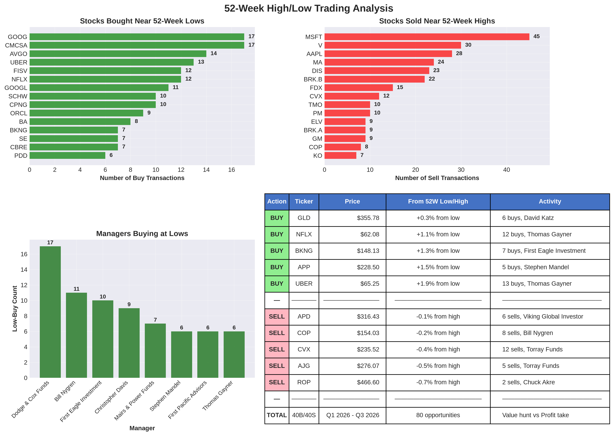

#### Hidden Gems Current
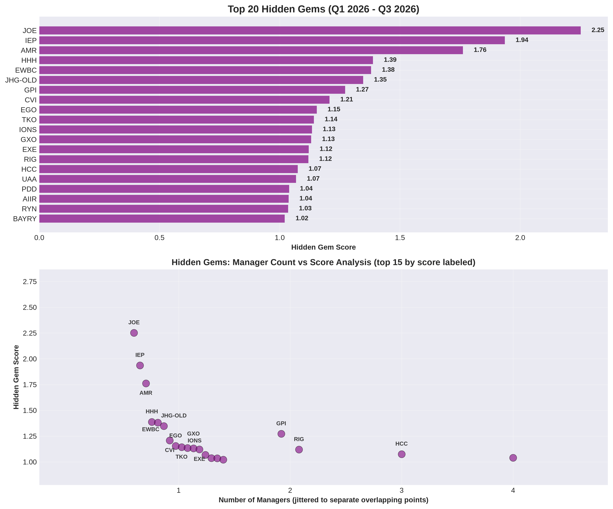

#### Low Price Accumulation Current
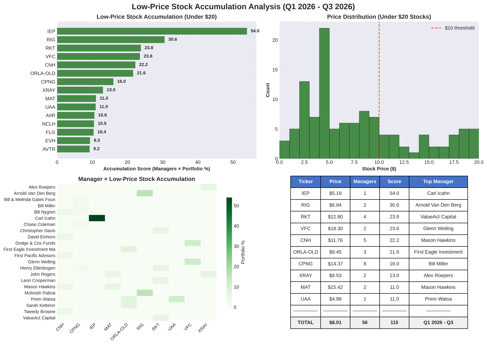

#### Momentum Analysis Current
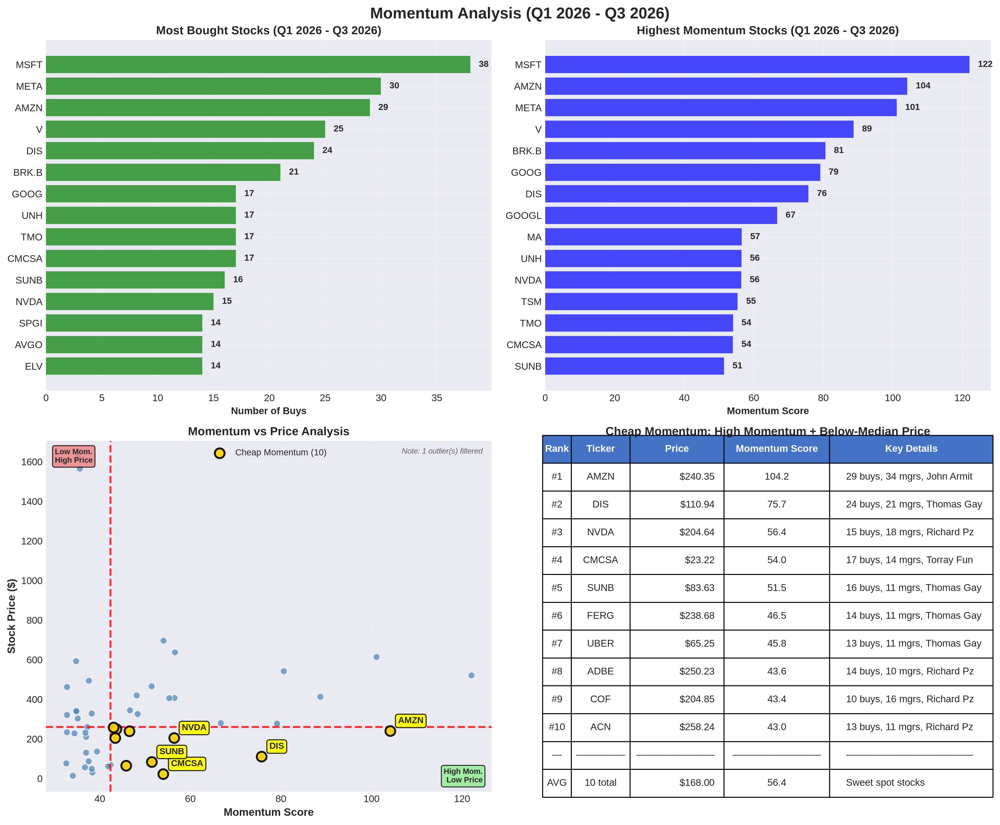

#### New Positions Current
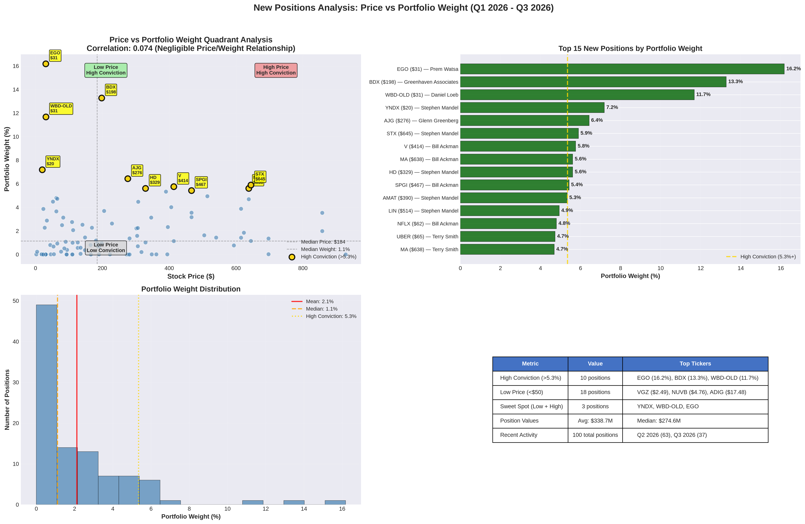

#### Portfolio Changes Current
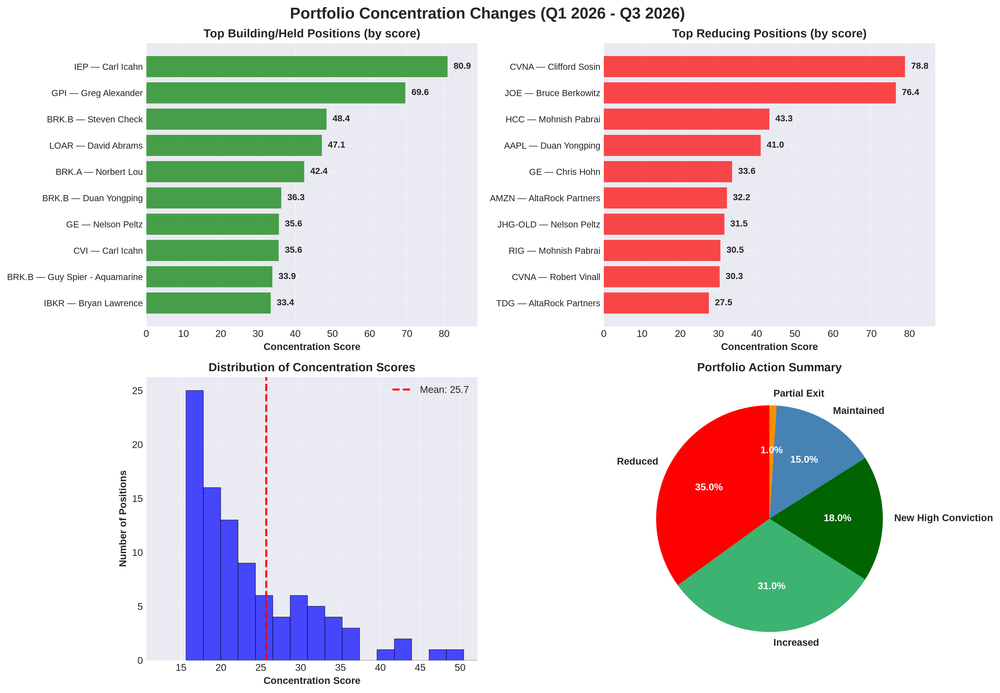

#### Price Opportunities Current
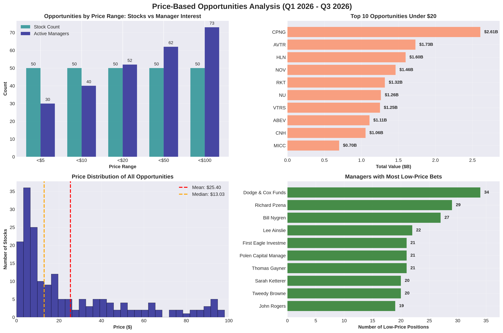

### 📋 Current Reports

| Report | Description | Key Insight |
| ------ | ----------- | ----------- |
| [52_week_high_sells.csv](current/52_week_high_sells.csv) | Profit taking patterns (40 items) | Strategic exits at peaks |
| [52_week_low_buys.csv](current/52_week_low_buys.csv) | Value hunting activity (40 items) | Managers buying at market lows |
| [concentration_changes.csv](current/concentration_changes.csv) | Portfolio shifts (100 items) | Major allocation adjustments |
| [contrarian_opportunities.csv](current/contrarian_opportunities.csv) | Against-the-trend plays (30 items) | Institutional contrarian bets |
| [deep_value_plays.csv](current/deep_value_plays.csv) | Deep value opportunities (30 items) | Undervalued institutional picks |
| [hidden_gems.csv](current/hidden_gems.csv) | Under-the-radar opportunities (50 items) | 5-factor scoring identifies stocks with high potential |
| [high_conviction_low_price.csv](current/high_conviction_low_price.csv) | Best value + conviction combo (29 items) | High conviction meets low price |
| [highest_portfolio_concentration.csv](current/highest_portfolio_concentration.csv) | Most focused positions (100 items) | Highest concentration institutional bets |
| [momentum_stocks.csv](current/momentum_stocks.csv) | Recent buying activity (50 items) | Tracks institutional accumulation patterns |
| [most_sold_stocks.csv](current/most_sold_stocks.csv) | Recent exit activity (50 items) | Most divested institutional positions |
| [new_positions.csv](current/new_positions.csv) | Fresh acquisitions (100 items) | Identifies emerging manager interests |
| [stocks_under_$5.csv](current/stocks_under_$5.csv) | Ultra-low price opportunities (50 items) | Deep value plays under $5 |
| [stocks_under_$10.csv](current/stocks_under_$10.csv) | Sub-$10 opportunities (50 items) | Manager favorites under $10 |
| [stocks_under_$20.csv](current/stocks_under_$20.csv) | Affordable growth plays (50 items) | Quality stocks at accessible prices |
| [stocks_under_$50.csv](current/stocks_under_$50.csv) | Mid-price value plays (50 items) | Institutional picks under $50 |
| [stocks_under_$100.csv](current/stocks_under_$100.csv) | Sub-$100 opportunities (50 items) | Value plays under $100 |
| [under_radar_picks.csv](current/under_radar_picks.csv) | Hidden gem opportunities (6 items) | Under-the-radar institutional picks |
| [value_price_opportunities.csv](current/value_price_opportunities.csv) | Multi-tier price analysis (40 items) | Comprehensive price-based screening |
| [stock_timelines.csv](current/stock_timelines.csv) | Position timeline tracking (200 items) | Quarter-by-quarter position changes per stock |

### 🌟 Top 5 Hidden Gems

| Ticker | Score | Price | Managers |
| ------ | ----- | ----- | -------- |
| **JOE** | 2.25 | $70.02 | Bruce Berkowitz |
| **IEP** | 1.94 | $5.19 | Carl Icahn |
| **AMR** | 1.76 | $159.19 | Mohnish Pabrai |
| **HHH** | 1.39 | $76.23 | Bill Ackman |
| **EWBC** | 1.38 | $130.81 | Li Lu |

---

## 🧠 Advanced Analysis (Manager Performance)

Deep insights into manager strategies, performance patterns, and decision-making.

### 📊 Visual Analysis

#### Accumulation Distribution Advanced
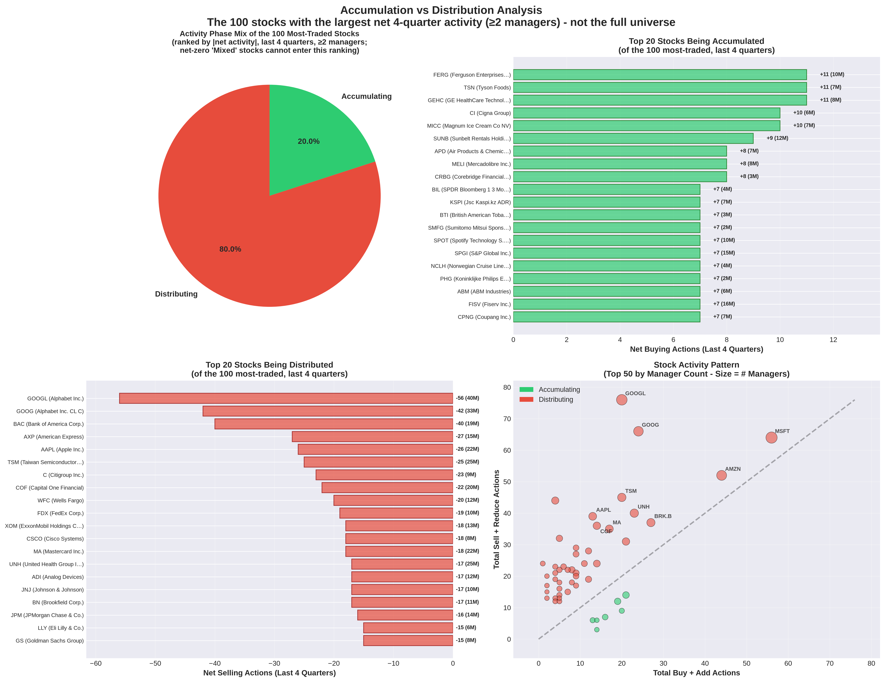

#### Consensus Picks Advanced
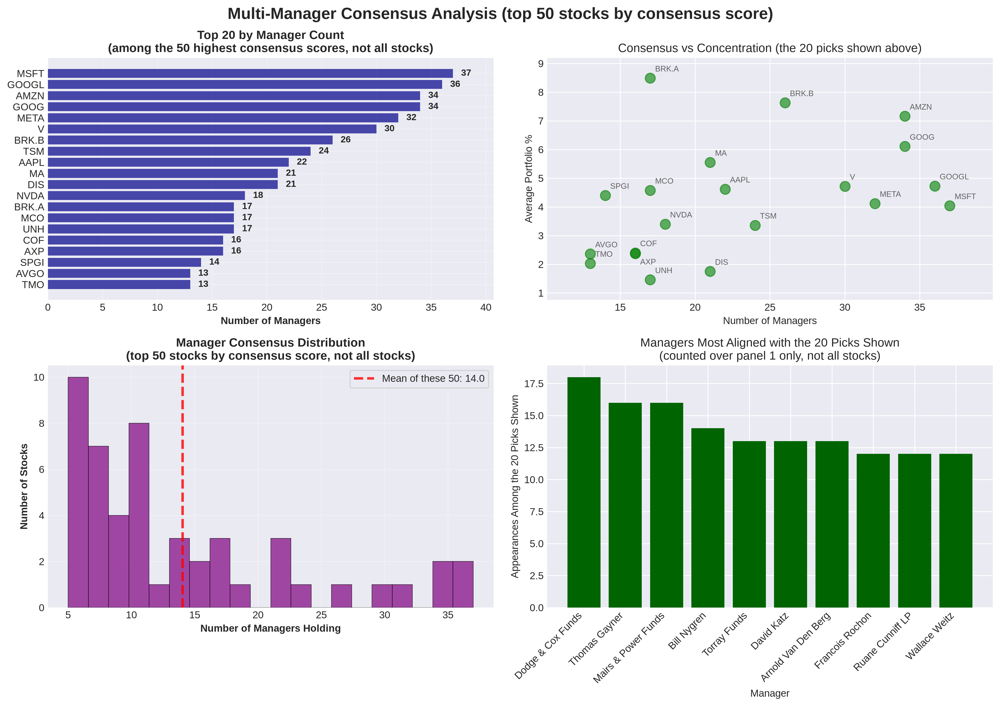

#### Crisis Alpha Advanced
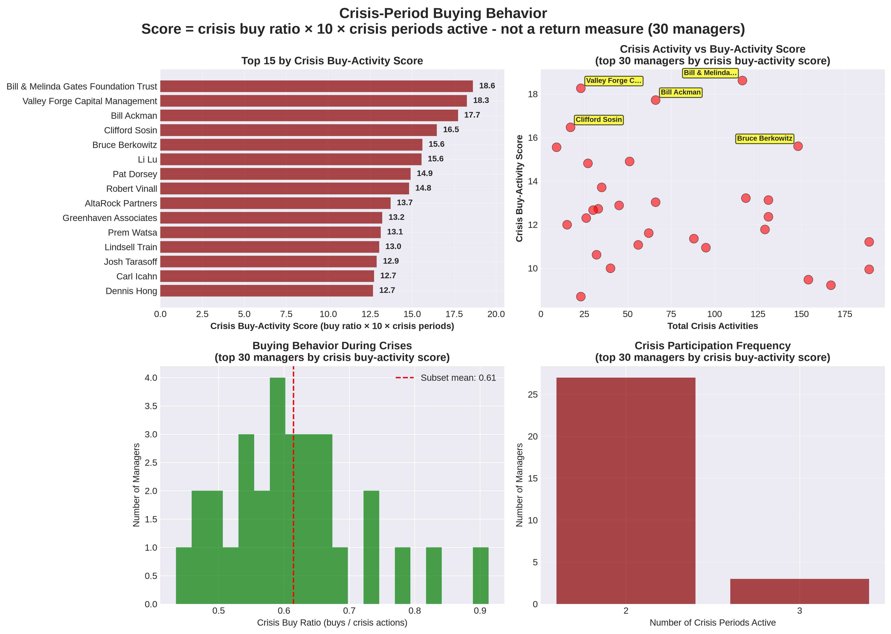

#### Manager Evolution Advanced
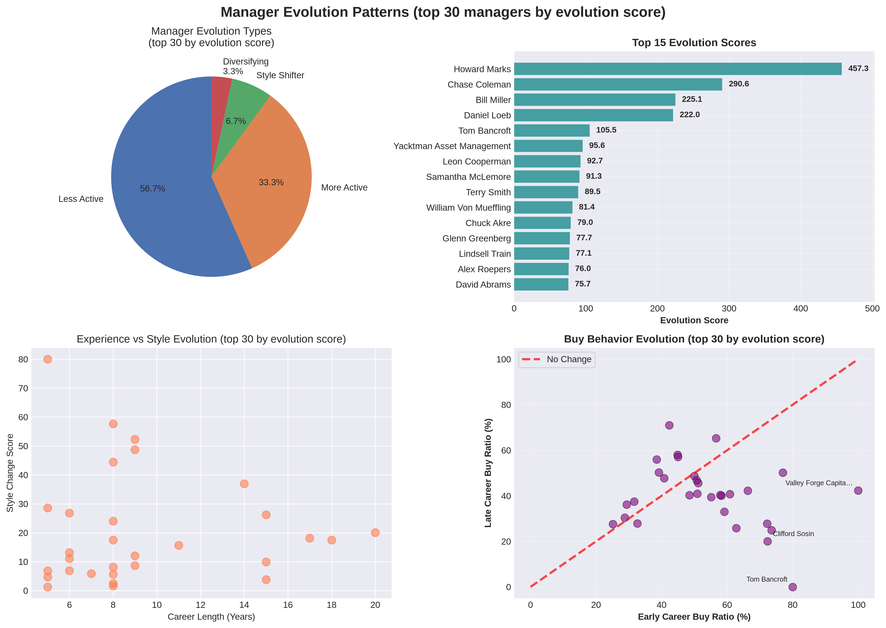

#### Manager Performance Advanced
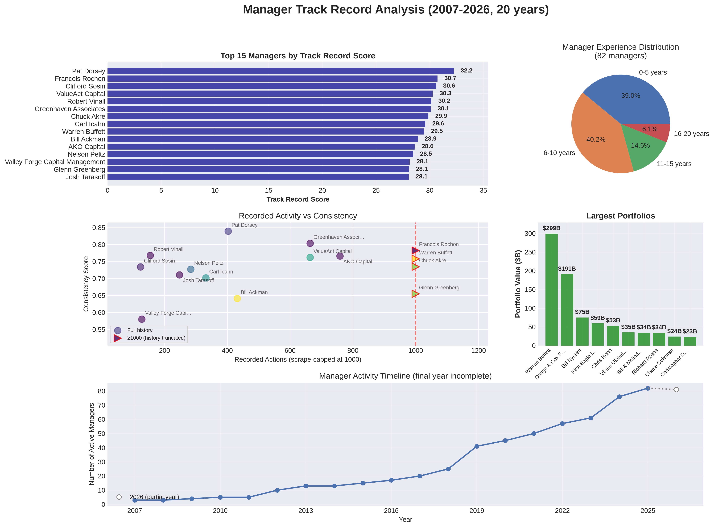

#### Position Sizing Advanced
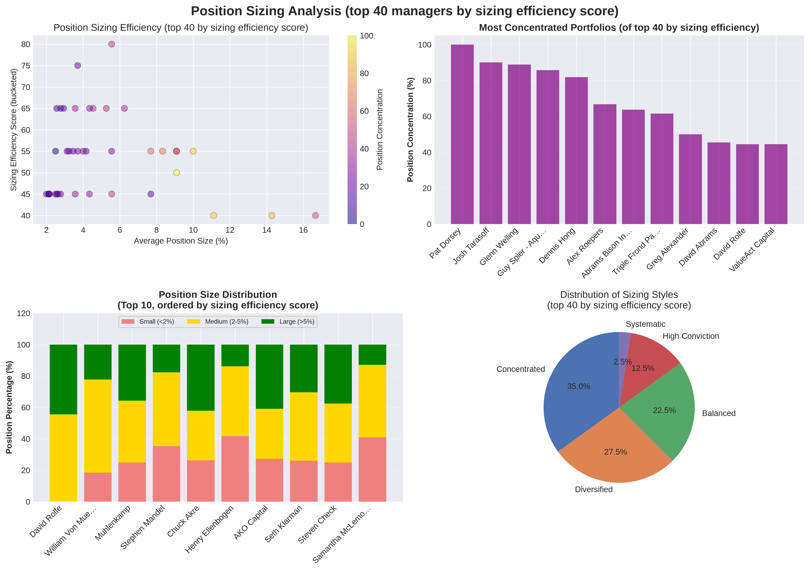

#### Top Holdings Advanced
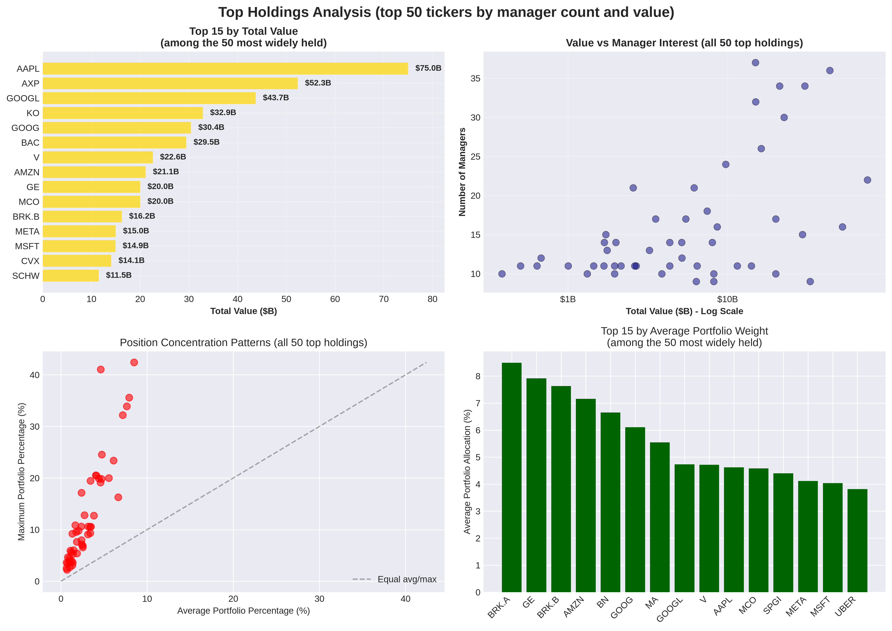

### 📋 Advanced Reports

| Report | Description | Key Insight |
| ------ | ----------- | ----------- |
| [position_building_timeline.csv](advanced/position_building_timeline.csv) | 📈 Position buildup/reduction over time (40911 items) | Quarter-by-quarter view of how managers accumulate & distribute positions |
| [accumulation_vs_distribution.csv](advanced/accumulation_vs_distribution.csv) | 🔄 Current phase tracking (100 items) | Identifies which positions are being built vs reduced RIGHT NOW |
| [position_flip_points.csv](advanced/position_flip_points.csv) | 🔀 Accumulation→Distribution transitions (96 items) | Pinpoints when managers switched from building to reducing |
| [action_sequence_patterns.csv](advanced/action_sequence_patterns.csv) | Trading pattern analysis (30 items) | Institutional buy/sell sequence patterns |
| [catalyst_timing_masters.csv](advanced/catalyst_timing_masters.csv) | Market timing excellence (30 items) | Managers with exceptional timing skills |
| [crisis_alpha_generators.csv](advanced/crisis_alpha_generators.csv) | Crisis period outperformers (30 items) | Managers who buy during crashes |
| [high_conviction_stocks.csv](advanced/high_conviction_stocks.csv) | Highest conviction positions (243 items) | Stocks with strongest institutional backing |
| [interesting_stocks_overview.csv](advanced/interesting_stocks_overview.csv) | Top-tier opportunities (100 items) | Multi-factor scoring of elite picks |
| [long_term_winners.csv](advanced/long_term_winners.csv) | Sustained institutional interest (61 items) | Stocks with long-term institutional backing |
| [manager_evolution_patterns.csv](advanced/manager_evolution_patterns.csv) | Strategy adaptation over time (30 items) | How managers evolve their approaches |
| [manager_performance.csv](advanced/manager_performance.csv) | Comprehensive manager evaluation (81 items) | Multi-dimensional performance metrics |
| [manager_track_records.csv](advanced/manager_track_records.csv) | Multi-year activity history (82 items) | Comprehensive manager scoring with consistency |
| [multi_manager_favorites.csv](advanced/multi_manager_favorites.csv) | Consensus high-conviction picks (50 items) | Stocks held by multiple elite managers |
| [position_sizing_mastery.csv](advanced/position_sizing_mastery.csv) | Optimal allocation patterns (40 items) | Advanced portfolio construction analysis |
| [sector_rotation_excellence.csv](advanced/sector_rotation_excellence.csv) | Elite sector allocation (30 items) | Superior sector rotation strategies |
| [sector_rotation_patterns.csv](advanced/sector_rotation_patterns.csv) | Institutional sector flows (335 items) | Sector rotation trend analysis |
| [theme_emergence_detection.csv](advanced/theme_emergence_detection.csv) | Early theme identification (25 items) | Emerging investment theme detection |
| [top_holdings.csv](advanced/top_holdings.csv) | Largest institutional positions (50 items) | Deep dive into major institutional holdings |

### 🏆 Top 15 Managers by Track Record Score (2007-2026)

| Rank | Manager | Score | Years Active | Total Actions |
| ---- | ------- | ----- | ------------ | ------------- |
| 1 | **Pat Dorsey** | 32.23 | 10 | 403 |
| 2 | **Francois Rochon** | 30.73 | 6 | 1000 |
| 3 | **Clifford Sosin** | 30.61 | 9 | 124 |
| 4 | **ValueAct Capital** | 30.27 | 15 | 664 |
| 5 | **Robert Vinall** | 30.16 | 8 | 155 |
| 6 | **Greenhaven Associates** | 30.08 | 8 | 664 |
| 7 | **Chuck Akre** | 29.87 | 15 | 1000 |
| 8 | **Carl Icahn** | 29.60 | 14 | 332 |
| 9 | **Warren Buffett** | 29.47 | 17 | 1000 |
| 10 | **Bill Ackman** | 28.89 | 20 | 432 |
| 11 | **AKO Capital** | 28.61 | 8 | 759 |
| 12 | **Nelson Peltz** | 28.46 | 12 | 284 |
| 13 | **Valley Forge Capital Management** | 28.13 | 8 | 128 |
| 14 | **Glenn Greenberg** | 28.07 | 15 | 1000 |
| 15 | **Josh Tarasoff** | 28.05 | 8 | 248 |

---

## 📚 Historical Analysis (19+ Years)

Long-term trends and patterns from 2007 to 2026.

### 📊 Visual Analysis

#### Crisis Response Comparison
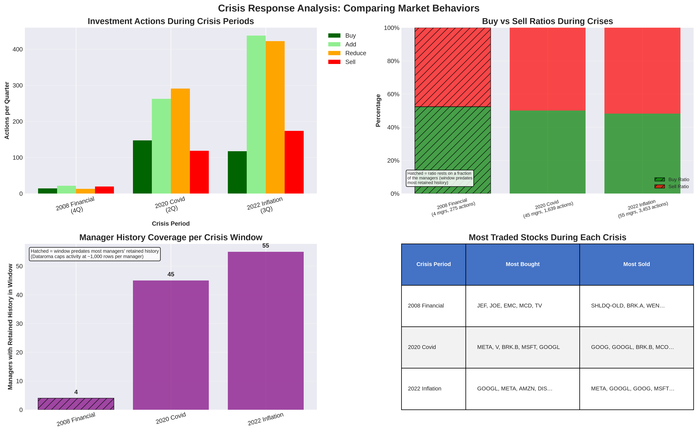

#### Multi Decade Conviction
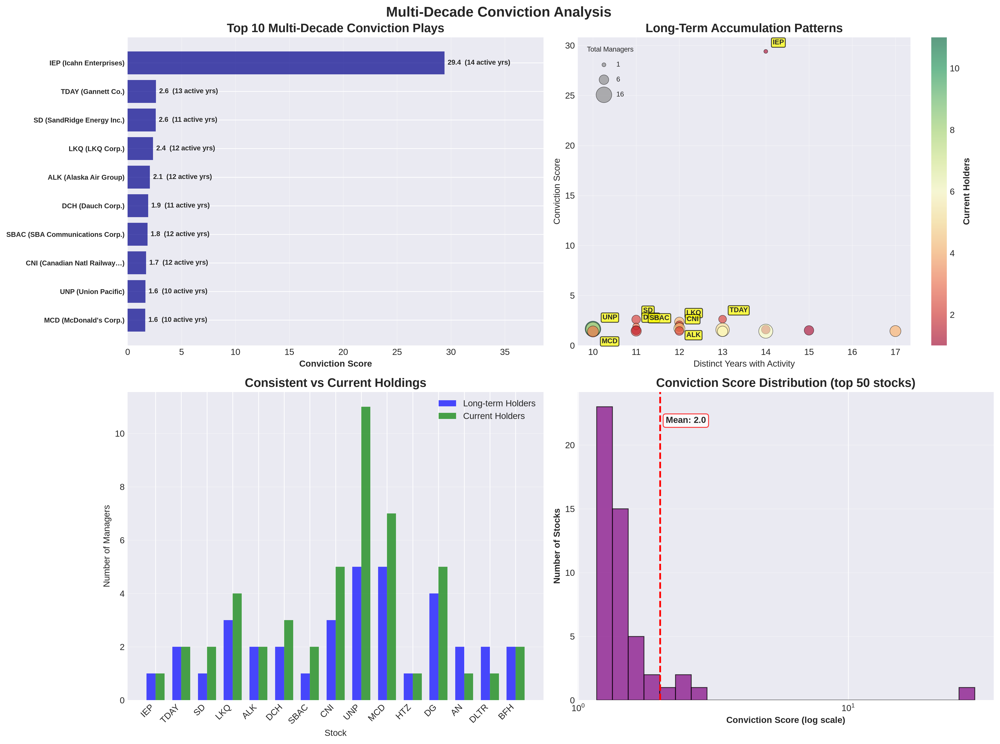

#### Quarterly Activity Timeline
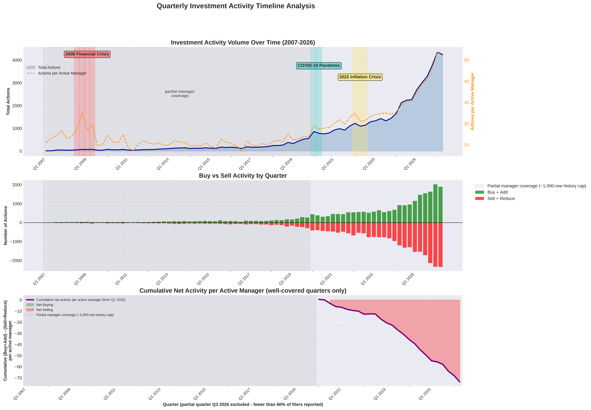

#### Stock Life Cycles
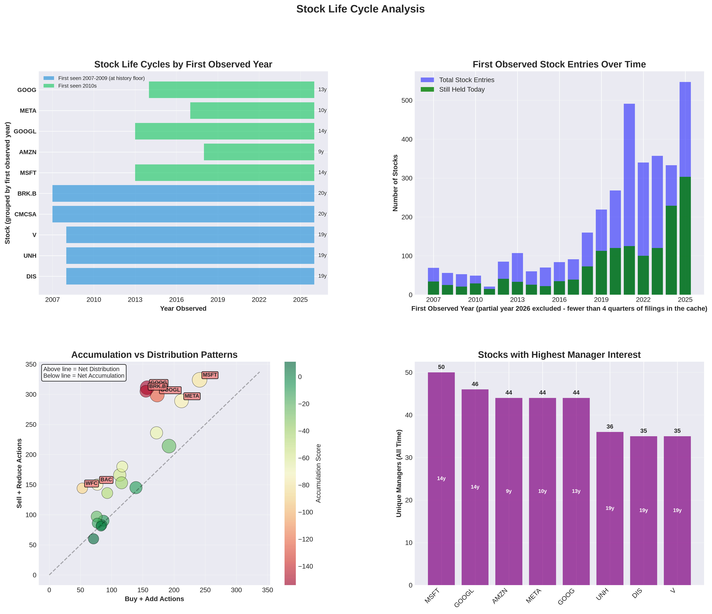

### 📋 Historical Reports

| Report | Description | Key Insight |
| ------ | ----------- | ----------- |
| [crisis_response_analysis.csv](historical/crisis_response_analysis.csv) | 2008 vs 2020 comparison (3 items) | Crisis behavior patterns across decades |
| [multi_decade_conviction.csv](historical/multi_decade_conviction.csv) | Stocks active in 10+ distinct years (50 items) | Ultimate long-term conviction plays |
| [quarterly_activity_timeline.csv](historical/quarterly_activity_timeline.csv) | Full-history activity map (79 items) | 79 quarters of market timing insights |
| [stock_life_cycles.csv](historical/stock_life_cycles.csv) | Complete holding patterns (3792 items) | Entry/exit patterns and optimal holding periods |

---

## 📐 Methodology

### Scoring Algorithms

#### Hidden Gem Score (0-10)
- **Exclusivity Factor** (30%): Fewer managers = higher score
- **Conviction Factor** (25%): Higher portfolio % = higher score
- **Recent Activity** (20%): Recent buys boost score
- **Momentum Factor** (15%): Multiple recent transactions
- **Manager Quality** (10%): Premium for top-tier managers

#### Track Record Score
Computed as: years_active x 0.3 + consistency_score x 20 + crisis_buying_ratio x 10 + 5 if the manager has current holdings.
- **Consistency**: Stability of activity across observed years
- **Crisis Buying**: Share of buy-side actions during the 2008 / 2020 / 2022 crisis windows
- **Longevity**: Years of observed activity

### Data Processing
- **Quarters**: Parsed from Dataroma period labels; filing period taken from each page
- **Price Data**: From Dataroma HTML at scrape time
- **Manager Mapping**: Clean names without timestamps
- **Activity Types**: Buy, Sell, Add, Reduce, Hold

### Analysis Periods
- **Current**: Q1 2026 - Q3 2026 (last 3 quarters)
- **Historical**: Q1 2007 - Q3 2026

## Understanding the Data

This section provides context for interpreting the analysis results, including edge cases and cross-file relationships.

### Momentum Analysis Details

The momentum analysis tracks institutional accumulation and distribution patterns. Higher scores indicate stronger buying pressure from multiple managers.

#### Top 20 Momentum Stocks

| Ticker | Company | Score | Buy Actions | Holders | Type |
| ------ | ------- | ----- | ----------- | ------- | ---- |
| **MSFT** | Microsoft Corp. | 122.0 | 38 | 37 | Recent Surge |
| **AMZN** | Amazon.com Inc. | 104.2 | 29 | 34 | Recent Surge |
| **META** | Meta Platforms Inc. | 101.1 | 30 | 32 | Recent Surge |
| **V** | Visa Inc. | 88.7 | 25 | 30 | Recent Surge |
| **BRK.B** | Berkshire Hathaway CL B | 80.6 | 21 | 26 | Recent Surge |
| **GOOG** | Alphabet Inc. CL C | 79.1 | 17 | 34 | Recent Surge |
| **DIS** | Walt Disney Co. | 75.7 | 24 | 21 | Recent Surge |
| **GOOGL** | Alphabet Inc. | 66.7 | 11 | 36 | Recent Surge |
| **MA** | Mastercard Inc. | 56.6 | 13 | 21 | Recent Surge |
| **UNH** | United Health Group Inc. | 56.5 | 17 | 17 | Recent Surge |
| **NVDA** | NVIDIA Corp. | 56.4 | 15 | 18 | Recent Surge |
| **TSM** | Taiwan Semiconductor S.A. | 55.4 | 12 | 24 | Recent Surge |
| **TMO** | Thermo Fisher Scientific | 54.0 | 17 | 13 | Recent Surge |
| **CMCSA** | Comcast Corp. | 54.0 | 17 | 14 | Recent Surge |
| **SUNB** | Sunbelt Rentals Holdings ... | 51.5 | 16 | 11 | Recent Surge |
| **SPGI** | S&P Global Inc. | 51.4 | 14 | 14 | Recent Surge |
| **AVGO** | Broadcom Inc. | 48.4 | 14 | 13 | Recent Surge |
| **ELV** | Elevance Health Inc. | 48.1 | 14 | 12 | Recent Surge |
| **AAPL** | Apple Inc. | 46.6 | 8 | 22 | Recent Surge |
| **FERG** | Ferguson Enterprises Inc. | 46.5 | 14 | 11 | Recent Surge |

**Interpretation:**
- **Recent Surge**: Strong recent accumulation across multiple quarters
- **Consistent Buyer**: Steady accumulation pattern over time
- **New Interest**: Fresh positions being established

### 52-Week Analysis Edge Cases

The 52-week high/low analyses use these filter criteria:

#### 52-Week Low Buys (`52_week_low_buys.csv`)

Stocks bought while trading near their 52-week low (`near_52w_low=True`).

- **40 stocks** currently meet this criterion
- Examples: GOOGL, GOOG, BAC
- These are being accumulated by value-focused managers

#### 52-Week High Sells (`52_week_high_sells.csv`)

Stocks sold while trading near their 52-week high (`near_52w_high=True`).

- **40 stocks** currently meet this criterion
- Examples: AAPL, KO, V
- 27 stocks show "Heavy Distribution" patterns

### New Positions Context

The analysis identified **100 new position entries** in the last 3 quarters. These represent fresh institutional interest.

#### Top New Positions by Total Value

| Ticker | Managers Initiating | Total Value | Avg Portfolio % |
| ------ | ------------------- | ----------- | --------------- |
| **MA** | Bill Ackman, Terry Smith | $1.73B | 5.15% |
| **FDXF** | Dodge & Cox Funds, Viking Global Investors | $1.44B | 0.79% |
| **NFLX** | Bill Ackman, Terry Smith | $1.43B | 4.23% |
| **V** | Bill Ackman, Chase Coleman | $1.40B | 3.45% |
| **SPGI** | Bill Ackman, John Armitage | $1.37B | 4.30% |
| **HD** | Stephen Mandel, Bill & Melinda Gates Foundation Trust | $1.27B | 3.32% |
| **STX** | Stephen Mandel, Chase Coleman | $1.24B | 3.53% |
| **YNDX** | Stephen Mandel | $1.18B | 7.19% |
| **BKNG** | First Eagle Investment Management, Bill Nygren | $1.15B | 0.91% |
| **BDX** | Greenhaven Associates | $1.06B | 13.28% |

### Cross-File Context

Some stocks appear in multiple analysis files with opposite signals, because different managers traded them in opposite directions.

#### Stocks in Both Contrarian and Momentum Reports

These tickers appear in both `contrarian_opportunities.csv` and `momentum_stocks.csv`. This happens when different managers take opposite positions on the same stock:

- **AAPL**: Contrarian signal: Net Selling (buys: 8.0, sells: 28.0) | Momentum score: 46.61545454545455

- **NVDA**: Contrarian signal: Net Selling (buys: 15.0, sells: 23.0) | Momentum score: 56.39666666666667

- **AVGO**: Contrarian signal: Net Buying (buys: 14.0, sells: 12.0) | Momentum score: 48.356153846153845

- **CMCSA**: Contrarian signal: Net Buying (buys: 17.0, sells: 10.0) | Momentum score: 54.02214285714286

- **ELV**: Contrarian signal: Net Buying (buys: 14.0, sells: 9.0) | Momentum score: 48.125

#### New Positions with Contrarian Signals

These newly initiated positions also show contrarian patterns, suggesting managers are taking bold positions against the crowd:
- **MA**: New position initiated amid contrarian activity
- **META**: New position initiated amid contrarian activity
- **TMO**: New position initiated amid contrarian activity

### Data Freshness Notes

**Analysis Window**: Q1 2026 to Q3 2026 (last 3 quarters)

All current analysis reports use manager filings from this window.

1. **Filing Lag**: SEC 13F filings are reported quarterly with a 45-day delay. Positions may have changed since filing.

2. **Historical Reference Columns**: Some reports include columns like `last_buy_period`, `first_established`, or `last_activity`. These carry dates from outside the 3-quarter window.

3. **Price Data**: Current prices are from the most recent scrape and may differ from the prices at which positions were established.

4. **Manager Activity**: A single manager may have multiple entries for the same stock if they made multiple transactions (Buy, Add, Reduce) within the analysis window.

**Report Generated**: 2026-11-01 12:22:59

---

## 📅 Update Schedule

This analysis is refreshed monthly to capture the latest investment trends and manager activities.

## 🔗 Data Source

All data is sourced from [Dataroma](https://www.dataroma.com), tracking portfolios of super investors.

---

*Analysis framework powered by modular Python architecture*